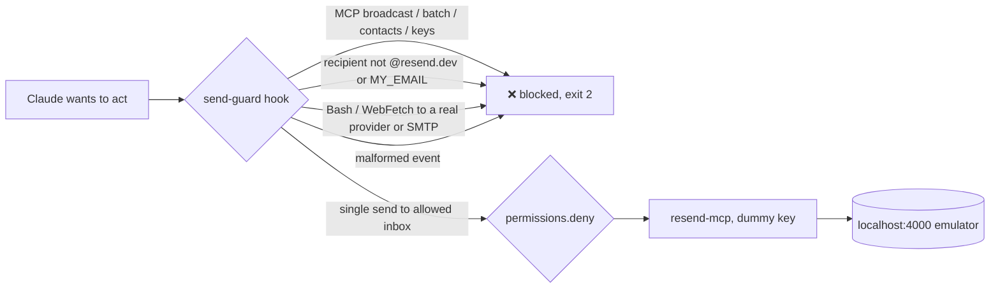

<div align="center">

# 🌶️ Clove & Copper — Email Studio

### A practice-only email marketing studio built with Claude Code, with guarded sends, a deterministic linter, and an LLM judge you can measure

[](https://github.com/Rehanrana11/email-studio/actions/workflows/ci.yml)


-lightgrey)

</div>

> [!NOTE]
> **Reviewing this for the lab?** [`LAB_MAP.md`](LAB_MAP.md) maps all 15 steps to their proof, and
> [`PROVENANCE.md`](PROVENANCE.md) shows which files started from another solution and which were added here.

> [!IMPORTANT]
> **This is a practice lab.** *Clove & Copper* and *The Spice Circle* are made up. There is no real customer and no
> real inbox. Every lead address ends in `@example.com` and every send goes to a local emulator on `localhost:4000`.

Plan a launch, write on-brand emails, personalize them per audience, check them with a linter and an LLM judge,
and send only to a local test inbox, with guardrails that make emailing a real person very hard to do by accident.

---

## ✨ What's inside

| Area | What it does |
|---|---|
| 🎙️ **Brand voice** | `brand/voice.md` (for people) and `studio.config.json` (for machines), kept in sync by a test. |
| 🗺️ **Campaign** | A 10-section launch plan and a 4-email sequence for *The Spice Circle*, with A/B sample sizes worked out. |
| 👥 **Fake leads** | 24 invented leads in 3 groups (curious / home-cooks / gifters), all `@example.com`, validated by tests. |
| ✉️ **Emails** | 4 base emails + 12 personalized versions, all lint-clean, with a CAN-SPAM-style footer. |
| 🛡️ **Send-guard hook** | Default-deny `PreToolUse` hook on MCP, Bash, PowerShell and WebFetch. Allows `*@resend.dev` and your `MY_EMAIL` only. |
| 📏 **Linter** | 30+ objective rules from `studio.config.json`. Every rule has a mutation test proving it can fail. |
| ⚖️ **LLM judge** | `claude -p --json-schema` review for judgement calls, gated with the linter. Errors never count as a pass. |
| 🎯 **Judge calibration** | Golden set + harness: confusion matrix, precision/recall, Cohen's κ, Wilson 95% CIs, flakiness across repeats. |
| 📦 **studio-kit plugin** | All of the above as a brand-agnostic Claude Code plugin with its own marketplace entry. |
| 🔁 **CI** | `node --test` on Ubuntu + Windows, plugin validation, and a real practice send against the emulator. |

---

## 🗂️ Layout

```
email-studio/
├── CLAUDE.md                          # studio golden rules (imports brand/voice.md)
├── studio.config.json                 # machine-checkable brand + offer rules
├── brand/voice.md                     # brand voice for humans
├── leads/{leads.csv,CLAUDE.md}        # 24 fake leads + folder rules
├── campaigns/spice-circle-launch/
│   ├── plan.md · sequence.md
│   ├── emails/                        # 01–04 base emails
│   └── personalized/{curious,home-cooks,gifters}/
├── .claude/
│   ├── settings.json                  # hook wiring + permissions.deny + marketing plugin
│   ├── settings.local.example.json    # copy to settings.local.json (gitignored) for MY_EMAIL
│   ├── rules/emails.md                # path-scoped rules for email files
│   └── skills/personalize/SKILL.md    # fork skill → writes + lints the 12 personalized emails
├── .mcp.json                          # resend-mcp (pinned) → localhost, dummy key
├── studio-kit/                        # the reusable plugin
│   ├── hooks/{send-guard.mjs,hooks.json}
│   ├── scripts/{lint-emails.mjs,review.mjs}
│   ├── review/schema.json
│   ├── agents/email-reviewer.md
│   └── skills/personalize/SKILL.md
├── scripts/                           # send-launch, calibrate-judge, gen/analyze-reviews
├── review/                            # golden set, waivers, deliberately bad sample
├── tests/                             # node --test suite
├── examples/client-two/               # a second made-up client (Rise & Crumb) on the same kit
├── evidence/                          # dated results of real runs (practice launch)
├── notes/                             # handoff, experiments, vetting log, review analysis
├── docs/index.html                    # project page (GitHub Pages)
├── LAB_MAP.md                         # lab step → proof → deviation and why
└── PROVENANCE.md                      # which files started from another solution, with scores
```

---

## 🛡️ Safety model: layers that fail independently



1. **Golden rules** in `CLAUDE.md`: practice server only, allowed recipients only, no broadcasts, no secrets, fake data only.
2. **Send-guard hook**, default-deny:
   - Email-provider MCP servers allow only `get-*`, `list-*`, `search-*` and single `send-email`. Everything else
     (`send-broadcast`, `send-batch-emails`, contacts, segments, API keys, forwards, replies) is blocked.
   - Recipients are read from `to`/`cc`/`bcc` only (so a `from` address can't trip it). Each must be on an allowed
     domain (exact match, so `x@resend.dev.evil.com` fails) or equal `MY_EMAIL`. Max 3.
   - Bash/PowerShell/WebFetch that reach a real provider (`api.resend.com`, SendGrid, Mailgun, SES, Postmark, …),
     an SMTP port, `sendmail`, `smtplib` or `nodemailer` are blocked.
   - Unparseable input fails closed.
3. **`permissions.deny`** in `.claude/settings.json` denies the dangerous MCP tools outright, before the hook runs.
4. **No real credentials.** `.mcp.json` hard-codes a dummy key and a localhost URL. It deliberately does **not**
   read `${RESEND_API_KEY}` from your shell, so a real key you have exported elsewhere can never leak in.
5. **The practice sender** refuses any non-localhost base URL, runs the same recipient check, and verifies the
   emulator inbox afterwards (every id landed, nothing went to a non-test address).

**Limits, stated plainly:** a hook is a guardrail, not a sandbox. An obfuscated hostname or a script file the
hook never sees could get past pattern checks. Layer 4 is what actually makes a real send impossible here.

---

## ⚖️ Linter vs judge: who checks what

| | Linter (`lint-emails.mjs`) | LLM judge (`review.mjs`) |
|---|---|---|
| Checks | Objective rules: length, emoji, ALL CAPS, `Re:`, CTA count, links, banned phrases, tokens + fallbacks, prices, deadline, UTMs, footer, lead data in copy | Judgement calls: *implied* health claims, *soft* urgency, guilt, a second CTA hidden in prose, invented offer terms, voice |
| Cost / speed | Free, milliseconds, deterministic | API call, seconds, stochastic |
| Proof it works | 31 mutation tests: each breaks one rule in a clean email and asserts the right finding | Golden set + `npm run calibrate` (accuracy, precision, recall, κ, 95% CIs) |
| In CI | Every push (`ci.yml`) | PRs that touch emails, if `ANTHROPIC_API_KEY` is set (`email-review.yml`) |

**Waivers** (`review/waivers.json`) suppress one judge finding in one file, only while the offending text is
unchanged (sha256), only until they expire, and never for health-claim, fake-urgency or misleading-subject findings.
A global "already resolved ids" list would let the same mistake back in through any other file.

---

## 🚀 Quick start

Needs Node 22+ and Claude Code. Commands work in bash and PowerShell unless noted.

```bash
npm test                     # 140 tests: guard, linter + mutations, leads, review gate + re-review, portability, wiring
npm run lint                 # lint all 16 emails

# Practice send (two terminals)
npm run emulator             # terminal 1: Resend emulator on http://localhost:4000
npm run send:launch          # terminal 2: email 01 per group → delivered@resend.dev, then verifies the inbox
npm run send:dry             # see the rendered emails without sending

# LLM review of one email (needs Claude CLI login or ANTHROPIC_API_KEY)
npm run review -- campaigns/spice-circle-launch/emails/01-get-the-pan-warm.md

# Measure the judge against the golden set
npm run calibrate -- --repeats 3
```

Optional, to receive practice mail yourself: copy `.claude/settings.local.example.json` to
`.claude/settings.local.json` (gitignored) and put your own address in `MY_EMAIL`.

---

## 🧪 How to verify it yourself

The `echo … | node` commands are for bash (on Windows, use Git Bash). `npm test` runs all of them on any OS.

| What | Command | Expected |
|---|---|---|
| Guard blocks a real lead | `echo '{"tool_name":"mcp__resend-practice__send-email","tool_input":{"to":["noor.halvorsen@example.com"]}}' \| node studio-kit/hooks/send-guard.mjs; echo $?` | `2` |
| Guard allows the test inbox | same with `"to":["delivered@resend.dev"]` | `0` |
| Guard blocks the real API from Bash | `echo '{"tool_name":"Bash","tool_input":{"command":"curl https://api.resend.com/emails"}}' \| node studio-kit/hooks/send-guard.mjs; echo $?` | `2` |
| Broadcasts always blocked | `"tool_name":"mcp__resend-practice__send-broadcast"` | `2` |
| Linter catches a bad email | `node studio-kit/scripts/lint-emails.mjs review/samples/bad-email.md` | exit `1`, 30 findings |
| Every linter rule can fail | `npm test` (see `tests/lint.test.mjs`) | 31 mutation tests pass |
| Judge errors are not passes | `tests/review.test.mjs` | garbage model output → exit `2` |
| Plugin is valid | `claude plugin validate ./studio-kit` | `Validation passed` |
| End-to-end send | `npm run emulator` + `npm run send:launch` | `Verified 3/3 … 0 to non-test addresses` |

---

## 🧭 Design decisions (and what I'd watch for in a lab like this)

- **Default-deny beats a denylist** for MCP servers. `resend-mcp` exposes ~150 tools; a regex for "broadcast"
  misses `send-batch-emails`, `forward-inbox-thread-email` and `create-api-key`, and a broad one blocks harmless
  `list-emails`. An allowlist of four verbs is shorter and safer.
- **Scan recipients, not every string.** Scanning the whole payload for addresses blocks legitimate sends (the
  `from` address) and teaches people to switch the guard off.
- **The hook has to see Bash.** If it only matches tools named like "send", `curl https://api.resend.com` walks
  straight past it.
- **Never interpolate a real key into `.mcp.json`.** `${RESEND_API_KEY:-dummy}` uses a real key if one is exported.
- **Read `structured_output`.** With `--json-schema`, the validated object is in the envelope's `structured_output`
  field; `result` is the text answer.
- **A gate that can't fail proves nothing.** Mutation tests for the linter; a golden set for the judge; tool
  errors exit 2, never 0.
- **Opens are not a metric you can trust** since Apple Mail Privacy Protection. A/B tests are judged on clicks,
  with the required sample size written down first.
- **Compliance in the copy:** every email carries an unsubscribe and a postal address (CAN-SPAM), and spice copy
  bans implied medical claims (FTC), which is the most likely real-world failure for this kind of brand.

---

## 📦 studio-kit (reusable plugin)

```bash
/plugin marketplace add Rehanrana11/email-studio
/plugin install studio-kit@clove-copper-studio
```
Ships the send-guard hook, the linter, the judge, the email-reviewer subagent and the personalize skill. Point it at
a new brand by writing a new `studio.config.json` and `brand/voice.md`. See [`studio-kit/README.md`](studio-kit/README.md).

---

## Known gaps / next steps
- The 12 golden labels are seed drafts. They need re-labelling by a human and growing to 50+ before any judge number is quotable.
- A/B variant tracking (`utm_content=email01-<group>-a`) isn't in the linter yet.
- No landing page; CTAs point at a fake domain.

## Provenance and credits
This repo is my solution to the **FDE-102 Email Studio** lab. It **started as a copy of**
[hafiznaveedchuhan-ctrl/my-email-studio](https://github.com/hafiznaveedchuhan-ctrl/my-email-studio)
(commit `a18df62`), which I re-branded from *Kettlebird Tea* to *Clove & Copper* and then extended with Claude Code.
47 files began as his; 43 were added here, including the linter and `studio.config.json`, the test suite, the
judge golden set and calibration, the waivers, the re-review, client two and the CI workflow. [`PROVENANCE.md`](PROVENANCE.md) lists every file
with a reproducible similarity score.

His repository has no licence, so the files that began as his are **not** under this repo's MIT licence and are
not claimed as mine. The author gave permission on 16 Nov 2026 for this repo to build on his and to be published
and submitted with this credit.

Also uses Anthropic's `marketing` plugin
([knowledge-work-plugins](https://github.com/anthropics/knowledge-work-plugins), Apache-2.0),
[`resend-mcp`](https://github.com/resend/resend-mcp) and [`emulate`](https://github.com/vercel-labs/emulate).

MIT © 2026 Rehan Masood, for the files listed as added in `PROVENANCE.md` only. See `LICENSE`.
